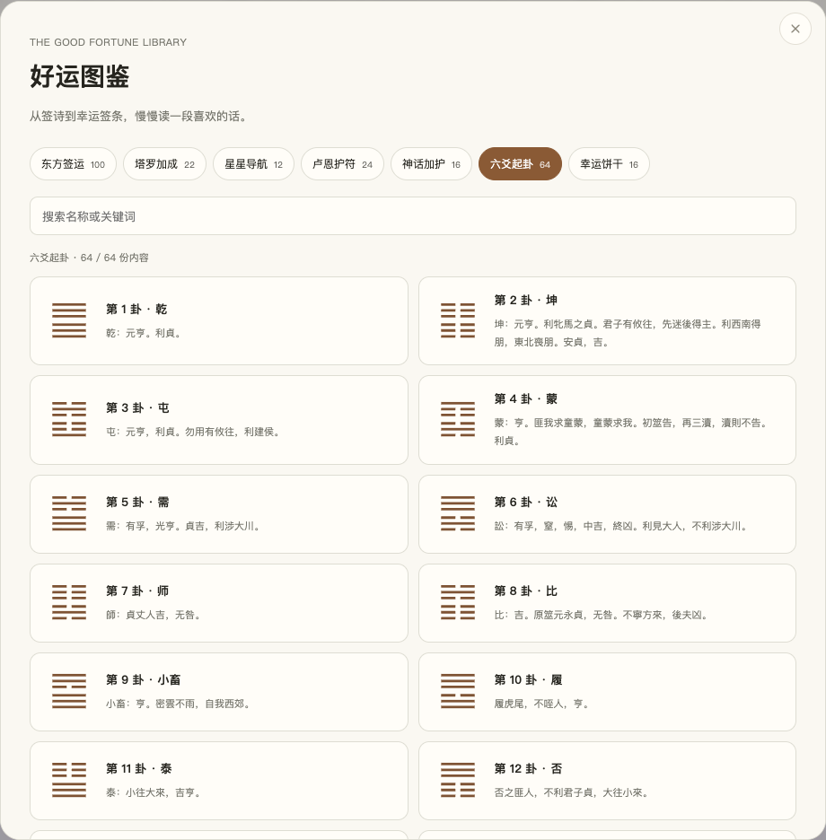

# 霸服

**玄学负责气氛，你负责人生。**

每天出门，叠满好运。一个集合东方与西方文化意象的每日 Buff 网页。

[打开霸服](https://yuchengmautk.github.io/bafu/)


## 七份好运

| 补给 | 内容 |
| --- | --- |
| 东方签运 | 100 支观音灵签，签等、签诗、典故与白话解读 |
| 塔罗加成 | 22 张大阿尔卡纳，独立的正位与逆位主题、行动提醒 |
| 星星导航 | 十二星座的文化象征、元素与今日行动 |
| 卢恩护符 | 24 个古弗萨克符文、刻纹石插画与历史背景 |
| 神话加护 | 16 位跨文化神话角色、故事与出处 |
| 六爻起卦 | 三钱六掷、本卦、动爻、之卦和六十四卦图鉴 |
| 幸运饼干 | 16 条原创英文签条、中文翻译与行动提醒 |

单项抽取先播放动画，再显示结果；一键仪式把七份好运合在一起揭晓。重抽会更新结果，查看和刷新保留最近一次。塔罗正逆位各有 50% 概率；内容池重抽避开上一次，六爻遵循三钱概率。

“好运图鉴”可浏览所有内容，支持关键词搜索；东方签运可筛选签等，塔罗可切换正逆位，六十四卦列表和详情均有对应卦图。浏览图鉴不改变抽取结果。



## 记录与分享

集齐七项后生成出门卡，可以保存 PNG 或复制分享文案。记录保存在当前网站的浏览器 localStorage 中；提供 JSON 备份与导入。换设备或从本地预览迁移到在线网站时，先导出备份，再在新网站导入。

页面运行不调用 LLM，也不向服务器发送抽取结果。所有插画都是项目原创 SVG，运行时资源均随站点提供。

## 本地运行

```bash
python3 -m http.server 4173 --bind 127.0.0.1
```

打开 `http://127.0.0.1:4173/`。使用原生 HTML、CSS、JavaScript，无需构建或安装运行依赖。

校验内容与 JavaScript（Node.js 22）：

```bash
node scripts/validate.mjs
for file in *.js; do node --check "$file"; done
```

## 部署

`.github/workflows/pages.yml` 在推送到 `main` 时校验内容，打包静态资源并部署到 GitHub Pages。仓库的 **Settings → Pages → Source** 使用 **GitHub Actions**。发布包仅包含网页文件，不包含文档、截图、测试脚本或本地配置。

## 内容与来源

现代主题、白话解读、行动建议、幸运饼干签条和插画由本站整理或原创。背景资料链接仅使用开放许可的 Wiki：

- [维基文库《周易》](https://zh.wikisource.org/wiki/周易)：公版卦辞与爻辞。
- [Wikipedia：Astrological sign](https://en.wikipedia.org/wiki/Astrological_sign)：星座背景。
- [Wikipedia：Elder Futhark](https://en.wikipedia.org/wiki/Elder_Futhark)：符文背景。
- [Wikipedia：Fortune cookie](https://en.wikipedia.org/wiki/Fortune_cookie)：幸运饼干背景。
- 神话详情提供相应文化的 Wikipedia 背景链接。

100 签保留此前整理的流传版本，尚待与开放许可 Wiki 文献逐条校核，不标称为维基文库来源。不同流传版本的签文、签等与典故可能不同。塔罗解读是本站的现代主题表达；星座不依据生日或实时星象。六爻目前提供卦象和原文参考，尚未实现纳甲、六亲、世应、日月建或用神断卦。

项目代码、原创插画及原创文案使用 [MIT License](LICENSE)。古籍原文按公版内容处理，外部 Wiki 的许可由对应站点说明。
